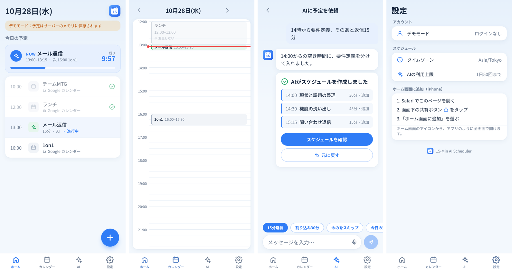

# AIスケジュールアシスタント

（開発名：15-Min AI Scheduler）

開いた瞬間に**今日の15分グリッドのタイムライン**が見えて、下のチャット欄で AI 秘書に予定を頼めるアプリ（PWA）。
「14時から要件定義1時間、そのあと問い合わせ返信15分」と送ると、AI が Google カレンダーの空き時間に15分単位で組み込みます。
変更はすぐ反映され、トーストの［元に戻す］で取り消せます。



## できること（MVP）

- 下部タブで **ホーム／カレンダー／AI／マイページ** を切り替え（Minimal Organic デザイン：オフホワイト × チャコール × エメラルド）
- **デザインの切り替え**：マイページの「デザイン」で［やさしい］［ストイック］を選べる。ストイックは Winter Arc などに打ち込む人向けの黒 × 水色の画面で、ホームに挑戦の進み具合（例：WINTER ARC  DAY 31 / 92。名前と期間はマイページで変えられる）と時間帯のひと言が出る。ひと言は AI（いちばん安い Haiku）が名言のように考え、朝・昼・夕方・夜に1回ずつ作ってこの端末に保存する（1回で今日の予算の 0.1% 未満。マイページでオフにでき、オフなら AI を使わない。上限に達したときはアプリが用意した言葉を出す。`lib/quote.ts`）。AI タブは「コーチ」になる。**`/arc`**（例：https://15-min-ai-scheduler-agent.vercel.app/arc）を開くとストイックになり（cookie に保存してトップへ移る）、ログイン画面もログイン後の画面もストイックで出る。トップ（`/`）は前回のデザインのまま（初めての人はやさしい）。ストイックでホーム画面に追加したアプリは `/arc` から始まる。ホーム画面のアイコンもデザインに合わせて出し分ける（ストイックは黒 × 水色のメーター。追加したときのデザインのアイコンになる）。選んだデザインは cookie に保存し、サーバーが最初から `<html data-theme>` を付けるのでちらつかない（`lib/theme.ts`、`app/globals.css`）
- **ホーム**：日付と挨拶、AI アシスタント、週表示（タップ・スワイプで日を切り替え）、アイコン付きの予定カード（場所・長さ・進行中の残り時間）、予定から作る「AIのおすすめ」（タップで AI の入力欄に依頼文が入る）
- **カレンダー**：15分グリッドのタイムライン（日送り可。AI の予定は青、メインのカレンダーの予定はグレーで「※ 変更しない」）
- **AI**：チャットで依頼すると、変更した予定を結果カードで表示し［スケジュールを確認］［元に戻す］ができる
- **毎日のルーティン**：マイページで「名前・開始〜終了・曜日」を登録すると、AI 専用カレンダーに繰り返しの予定として入る。AI は頼まれたときだけ、その日の分を動かす・スキップする（「15分延長」などでまとめてずれることはない）。変更・削除は今日以降に反映し、過去の分は残す。睡眠（23:00〜翌7:00）や授業のような長いもの（最大23時間45分・日付をまたいでもよい）も登録できる
- **AIへのカスタム指示**：マイページの「AIの使い方」で、予定の組み方や返事の好み（500字まで）を書いておくと、チャットと「AIで更新」で毎回 AI に渡す（Supabase の `user_settings` に保存し端末間で共有）。毎回送るので、長いほど使用量が増える（画面に目安を表示）。節約モードでアプリが処理する依頼には使わない
- **使い方（チュートリアル）**：初めて開いたときに、やさしい・ストイックそれぞれの文と見た目で5枚の説明を出す（この端末で1回だけ。マイページからもう一度見られる）
- **予定の通知**：通知は Google カレンダーが出す。AI の予定は「AIスケジューラー」の「デフォルトの通知」に従うので、その設定のしかたをマイページの「予定の通知（Googleカレンダー）」で説明している
- **チャット履歴**：AI との会話は保存され、再読み込みしても結果カードごと見返せる（30件ずつ、さかのぼって読める）。マイページから削除できる
- チャット / 音声入力で予定を追加・移動・削除。大きいタスクは AI が15〜60分のアクションに分解
- ワンタップの**クイックボタン**（初期値は「15分延長」「割り込み30分」「今のをスキップ」「今日の残りを組み直して」）。AI 画面の［編集］かマイページから、好きな言葉を8個まで追加・並べ替え・削除でき、Supabase（`user_settings`）に保存して端末間で共有する。節約モードで AI を使わずに処理できる言葉には「AIなし」の印が付き、AI の上限に達しても押せる
- **割り込みモード**：AI 画面でオンにすると、「45分 買い物」と送るだけで、すぐに割り込ませる。開始は［今すぐ］（次の15分の区切り）か［今の予定の後］、後ろの予定は［スライド］（割り込みの分だけ後ろ倒し。進行中の予定は切って「（続き）」に）か［削る］（重なった分だけ削り、そのあとはそのまま）から選ぶ。メインの予定とルーティンは動かさない
- **AIの使い方（節約／通常／強化／最大）**：マイページで切り替え、すべてのチャットに効く（ホームの「AIで更新」＝AIブリーフは、モードに関係なくいつも Sonnet）
  - 節約：「14時から会議1時間」「明日 資料作成2時間」「15分延長」「今のをスキップ」「割り込み30分」のような決まった形の依頼をアプリで処理し、それ以外は Haiku が考える（読み取りは `lib/commands.ts`）
  - 通常：すべての依頼を Haiku が考える
  - 節約・通常とも、「組み直して」「整理」「分析」や予定が2つ以上の依頼など、難しい依頼だけ Sonnet に回す（判定はアプリで行う。`lib/claude.ts` の `isHardRequest`）
  - 強化：すべての依頼を Sonnet が考える
  - 最大：すべての依頼を Opus が考える（考える量も多め）。「直近2週間の時間の使い方を分析して」のように、カレンダーを振り返って時間の浪費や改善点を調べる用途向け。プランがプロのときだけ使える
  - モデルは `lib/claude.ts` の `MODELS` で決める（環境変数 `ANTHROPIC_MODEL` は使わない）
  - 使用量を節約したいときは、「14時から〇〇1時間」のように時刻と長さをはっきり書いて1件ずつ送ると、AIを使わずに処理されやすくなります（マイページと AI 画面にも表示）
- 1回のチャットで行った変更をまとめて **Undo**
- AI の予定は Google カレンダーの**専用カレンダー「AIスケジューラー」**に入る（自動で作成・色分け）。メインのカレンダーは読むだけの権限で、変更しない
- **プラン（無料／ライト 480円／スタンダード 1,780円／プロ 1,980円）**：AI の1日・1か月の上限、使えるモード（無料は節約だけ、強化はライトから、最大はプロだけ）、AIブリーフ・カスタム指示、広告の量が変わる。決まりは `lib/plans.ts`。表は [docs/stripe-setup.md](docs/stripe-setup.md)
  - スタンダードはプロと200円差で AI は半分以下（おとりの値段）。プロには「おすすめ」の印だけを付ける（おとりだと分かる案内や、1回あたりの値段は出さない）
  - マイページの「プラン」から Stripe で申し込み・変更・解約できる。設定のしかたは [docs/stripe-setup.md](docs/stripe-setup.md)
  - 使えないモードは、マイページで鍵の印が付く。サーバーでも、使えるいちばん上のモードに下げる
  - 広告：無料は小さい広告と全画面広告（開いたとき3時間に1回・AI の返事3回に1回。`components/Interstitial.tsx`）、ライトはホームの小さい広告だけ（`components/AdSlot.tsx`）。中身は今は有料プランの案内
  - 「AIで更新」（AIブリーフ）：無料は使えない、ライトは1日1回（1回で今日のAIの約2割を使うことをホームに明記）
  - カスタム指示：有料だけ（無料では、前に保存した指示も AI に渡さない）
  - 規約などのページ：`/legal/terms`・`/legal/privacy`・`/legal/tokushoho`（中身は `lib/legal.ts`）

## 構成

```
[ ブラウザ / PWA ] ── Next.js (App Router, Vercel)
                         ├─ Auth.js (Google OAuth, scope: calendar.events)
                         ├─ /api/chat ── Claude API (tool use) ──► Google Calendar API
                         ├─ /api/events, /api/status, /api/undo
                         └─ Supabase（ユーザー・暗号化したリフレッシュトークン・操作ログ・チャット履歴・利用回数）
```

| パス | 役割 |
|---|---|
| `app/page.tsx` | ログイン画面 / メイン画面 |
| `components/` | `Scheduler`（状態とタブ）、`HomeView`・`CalendarView`・`ChatView`・`SettingsView`（各タブ）、`TabBar`、`ResultCard`、`icons` |
| `app/api/chat` | メッセージ → AI エージェント → 返答と Undo 用 `opId` |
| `app/api/events` | `GET ?date=YYYY-MM-DD&tz=…` その日の予定 |
| `app/api/status` | `GET` 今のブロックと残り時間・次の予定（ウィジェット・ショートカット用） |
| `app/api/undo` | `POST { opId }` そのチャットの変更をまとめて取り消す |
| `lib/agent.ts` | Claude とのツール呼び出しループ、システムプロンプト |
| `lib/tools.ts` | AI が使うツール：`get_schedule` / `create_blocks` / `update_block` / `delete_block` / `shift_following` / `interrupt` |
| `lib/interrupt.ts` | 割り込み（文から長さとタイトルを読む・スライド／削る）。節約モードでは AI を使わずにこれだけで処理する |
| `lib/calendar/` | カレンダーの読み書き（`google.ts` 本番、`memory.ts` デモ・テスト） |
| `lib/ops.ts` | 変更の記録と Undo |
| `lib/store/` | 操作ログ・履歴・利用回数の保存（Supabase / メモリ） |
| `supabase/schema.sql` | DB スキーマ（AI のおすすめ／AIブリーフは `briefs` に、日付と口調ごとに保存） |

AI ブロックは、アプリが自動で作る専用カレンダー（id は `users.ai_calendar_id`）に入れて見分けています。メインのカレンダーは `calendar.events.readonly` で読むだけです。

## まずデモで動かす（Google / Supabase 不要）

```bash
npm install
echo "DEMO_MODE=1" > .env.local
echo "ANTHROPIC_API_KEY=sk-ant-..." >> .env.local   # チャットを試すなら
npm run dev   # → http://localhost:3000
```

デモモードではログインなしで、予定はサーバーのメモリに保存されます（再起動で消えます）。

## 本番セットアップ

### 1. Google Cloud（ログインとカレンダー）

1. [Google Cloud Console](https://console.cloud.google.com/) でプロジェクトを作成
2. 「API とサービス」→「ライブラリ」で **Google Calendar API** を有効化
3. 「OAuth 同意画面」
   - ユーザーの種類：**外部**、公開ステータス：**テスト**
   - スコープ（データアクセス）に次の2つを追加
     - `.../auth/calendar.events.readonly`（メインのカレンダーを読む）
     - `.../auth/calendar.app.created`（AI 専用カレンダーを作って書き込む）
   - **テストユーザー**に自分（と試してもらう人）の Google アカウントを追加（最大100人）
4. 「認証情報」→「OAuth クライアント ID」→ 種類：**ウェブアプリケーション**
   - 承認済みのリダイレクト URI：
     - `http://localhost:3000/api/auth/callback/google`
     - `https://<本番ドメイン>/api/auth/callback/google`
   - クライアント ID / シークレットを `AUTH_GOOGLE_ID` / `AUTH_GOOGLE_SECRET` に

### 2. Supabase（データ保存）

1. [Supabase](https://supabase.com/) で New project
2. SQL Editor で `supabase/schema.sql` を実行（何度実行しても大丈夫。アップデートで列が増えたときも、もう一度実行すればよい）
3. Project Settings → API の **Project URL** と **service_role** キーを `SUPABASE_URL` / `SUPABASE_SERVICE_ROLE_KEY` に（service_role はサーバーの環境変数だけに置く）

### 3. 環境変数

`.env.example` を `.env.local` にコピーして埋めます。

```bash
npx auth secret             # AUTH_SECRET を生成
openssl rand -base64 32     # TOKEN_ENC_KEY を生成
```

### 4. Vercel にデプロイ

1. Vercel でこのリポジトリをインポート（フレームワークは Next.js が自動で選ばれる）
2. Environment Variables に `.env.local` と同じ値を登録（`DEMO_MODE` は入れない）
3. デプロイ後、本番 URL のリダイレクト URI を GCP に追加
4. スマホで開いて「ホーム画面に追加」するとアプリのように使えます
   - iPhone：Safari で開き、共有ボタン →「ホーム画面に追加」
   - Android：Chrome で開き、右上のメニュー（︙）→「ホーム画面に追加」→「インストール」（または「追加」）

`https://<本番ドメイン>/api/health` を開き、`"ready": true`（すべての項目が `ok`）になっていれば準備完了です。`ng` の項目は、その環境変数が未設定か、`supabase_schema` なら `schema.sql` が未実行か Supabase の URL・キーが違います。

## 開発

```bash
npm run dev         # 開発サーバー
npm test            # ユニットテスト（時刻計算・空き枠・ツール・Undo・エージェントのループ）
npm run lint
npm run typecheck
npm run build
```

## 一般公開に向けて

- `calendar.events` は Google の**センシティブスコープ**です。テストユーザー以外に公開するには、OAuth 同意画面の**アプリ審査**（プライバシーポリシー、利用規約、デモ動画など）が必要です。
- AI の費用は、プランごとの**1日と1か月の予算（`lib/plans.ts`）**で抑えています。依頼ごとに Claude が返すトークン数から実際の費用を計算して足し、どちらかを使い切ると AI を呼びません（画面には「残り◯％」と表示）。料金表は `lib/pricing.ts`。エラーになった依頼も、AI を呼んだ分は数えます。［元に戻す］と手動編集は AI を使わないので減りません。
- リフレッシュトークンは `TOKEN_ENC_KEY` で AES-256-GCM 暗号化して保存しています。キーを変えると全員再ログインが必要です。

## セキュリティ

| 対策 | 場所 |
|---|---|
| 画面に nonce 付きの Content-Security-Policy（外部・注入スクリプトを実行させない）、iframe 埋め込み禁止など | `proxy.ts`、`next.config.ts` |
| API への書き込みは、このアプリの画面から来たものだけ受け付ける（CSRF 対策。Origin / Sec-Fetch-Site を確認） | `proxy.ts` |
| 全 API でログインを確認し、データは必ずログイン中のユーザーのものだけを読む・書く | `lib/context.ts`、`lib/store/` |
| AI の予算は依頼の前に先に押さえるので、同時に大量に送られても予算（1日・1か月）を大きく超えない | `lib/budget.ts` |
| プランに無いモードはサーバーで下げる。Stripe からの知らせ（webhook）は署名で確かめ、プランは Stripe から読み直して決める。カードの情報はアプリに届かない | `app/api/chat/route.ts`、`lib/billing.ts` |
| 招待された予定のタイトルに書かれた指示には AI が従わない（プロンプトインジェクション対策）。AI が変えられるのは AI 専用カレンダーだけ | `lib/agent.ts`、`lib/tools.ts` |
| リフレッシュトークンは AES-256-GCM で暗号化。DB は RLS で外から読めず、関数もサーバーだけが呼べる | `lib/crypto.ts`、`supabase/schema.sql` |
| 本番（Vercel の Production）では `DEMO_MODE` を入れてもデモモードにならない | `lib/demo.ts` |
| 依存パッケージの脆弱性を Dependabot が毎週確認 | `.github/dependabot.yml` |

## ロードマップ

1. ~~MVP：タイムライン + チャットで追加・移動・削除・後ろ倒し + Undo~~
2. ブロック終了時の Web Push 通知、「延長／完了／スキップ」の通知アクション、週ビュー
3. iOS ショートカット・LINE Bot からの入力（`/api/status` + API トークン）、タスクの持ち越し
4. 公開準備：OAuth 審査、LP
5. ~~**プラン（無料・広告あり／ライト／スタンダード／プロ）**と Stripe の課金~~ → 済み（[docs/stripe-setup.md](docs/stripe-setup.md)）。残りは広告の事業者（[docs/plans-todo.md](docs/plans-todo.md)）
